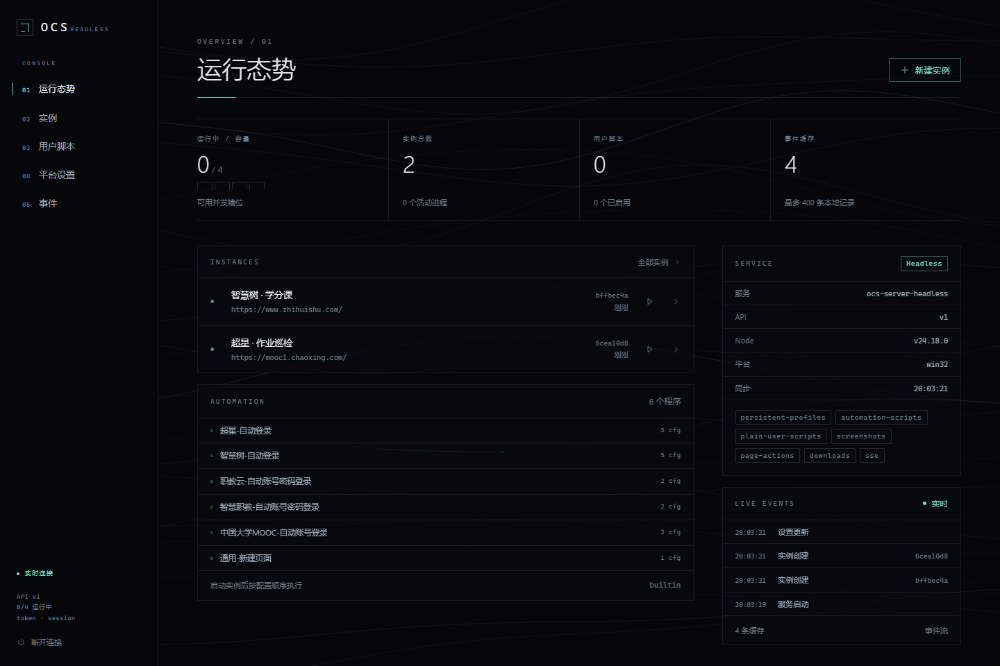

# OCS Server Headless

面向 Linux 服务器的无头浏览器自动化服务，提供同源 Web 控制台和管理 API。浏览器在服务端运行，无需桌面会话；关闭控制台不会中断正在运行的实例。

- 独立浏览器实例、用户目录和 worker，支持启动、停止与重启。
- 内置自动化、普通 JavaScript 和标准用户脚本，支持网络/文件导入、版本更新与脚本管理器安装。
- OCS 配置同步、软件辅助动作、可配置 OCR、实时预览、资源监测和加密数据导入导出。
- 管理令牌认证、实时事件流、加密配置和持久化浏览器数据。



## 新服务器部署

本项目以纯源码分发，默认不依赖 Releases、Actions 或已发布的应用镜像。取得完整源码后，推荐在服务器上通过 Docker 构建并启动；Node.js、Web 控制台、生产依赖、锁定版本的 Chromium 和系统共享库由 Dockerfile 统一准备，宿主无需安装 Node.js 或 pnpm。

### 1. 准备服务器

部署目标为 **Linux x86_64（amd64）**，需要 bash、Docker Engine 和 Docker Compose 插件。确保 Docker 已启动，且当前账号有权访问：

```bash
docker info
docker compose version
```

宿主内核需允许非特权用户命名空间，以运行 Chromium sandbox。容器使用普通用户，浏览器运行时保留 sandbox。

### 2. 获取源码并部署

通过 Git 克隆仓库，或下载并解压源码压缩包。进入包含 `Dockerfile`、`package.json` 和 `packages/` 的仓库根目录，执行：

```bash
bash deploy/install.sh
```

脚本会创建 `deploy/.env`、校验 Compose 配置、从源码构建镜像并等待服务健康。已有配置和数据卷会保留；构建失败时不会停止正在运行的旧服务。

首次构建需要网络下载基础镜像、依赖和 Chromium。运行镜像包含完整前后端和浏览器环境，启动时不再下载这些依赖。缺少 `.github/` 目录或任何预构建产物不影响该流程。

### 3. 登录控制台

安装脚本不会改变当前终端目录。进入 `deploy/`，读取自动生成的管理令牌；后续日常操作也在此目录执行：

```bash
cd deploy
docker compose exec -T ocs node -e 'process.stdout.write(require("fs").readFileSync("/data/admin.token","utf8"))'
```

访问 [http://127.0.0.1:15319/](http://127.0.0.1:15319/)，使用令牌登录。默认端口绑定在服务器的回环地址；通过其他电脑访问时，使用下一节的 SSH 隧道或 HTTPS 反向代理。

服务重启后会保留实例配置和浏览器数据，浏览器实例需在控制台重新启动。

## 远程访问与配置

通过 SSH 隧道访问时，在访问服务器的电脑上执行：

```bash
ssh -L 15319:127.0.0.1:15319 user@server
```

保持连接，再在浏览器打开 [http://127.0.0.1:15319/](http://127.0.0.1:15319/)。将 `user@server` 替换为服务器的 SSH 账号和地址。

需要域名访问时，使用 HTTPS 反向代理转发到服务器的回环端口，同源提供控制台与 API。将外部 Origin 写入 `.env` 的 `OCS_ALLOWED_ORIGINS`，例如 `https://ocs.example.com`；为 `/api/v1/events` 保留 SSE 长连接并关闭代理缓冲。

仓库中的 `deploy/.env` 支持以下配置：

| 配置 | 默认值 | 用途 |
| --- | --- | --- |
| `OCS_BIND_ADDRESS` | `127.0.0.1` | 宿主监听地址 |
| `OCS_PORT` | `15319` | 宿主端口 |
| `OCS_MAX_BROWSERS` | `4` | 同时运行的浏览器实例上限 |
| `OCS_ALLOWED_ORIGINS` | 空 | 逗号分隔的精确 Origin；HTTPS 反向代理需设置外部 Origin |
| `OCS_OCR_URL` | 空 | 容器可访问的兼容 OCR 服务地址 |
| `OCS_SCRIPT_MANAGER_URL` | 空 | 可选脚本管理器 ZIP 镜像 |
| `OCS_MIN_FREE_MEMORY_MB` / `OCS_MAX_CPU_PERCENT` | `0` | 启动资源阈值；0 表示关闭该项检查 |

仅修改配置时，在 `deploy/` 执行以下命令，使用已有镜像重新创建服务：

```bash
docker compose up --detach --no-build --pull never --wait --wait-timeout 90
```

这些变量由 Compose 读取并传入服务。容器内部端口固定为 `15319`，数据目录固定为 `/data`。

## 运行、备份与升级

日常操作均在仓库的 `deploy/` 目录执行：

| 命令 | 用途 |
| --- | --- |
| `docker compose ps` | 查看服务状态 |
| `docker compose logs --tail=100 ocs` | 查看最近日志 |
| `docker compose restart ocs` | 重启服务 |
| `docker compose stop` | 停止服务 |
| `docker compose start` | 启动已停止的服务 |

启动时会使用临时 profile 检查 Chromium 和 sandbox，失败原因可在日志中查看。`/healthz` 用于检查 HTTP 进程存活，不代表所有浏览器实例或自动化任务均正常。

### 备份数据

数据保存在 `ocs-server-headless_ocs-data` 卷中，包括配置数据库、加密密钥、管理令牌、浏览器 profile、下载和日志。停止服务后备份完整目录：

```bash
docker compose stop
docker compose cp ocs:/data "./backup-$(date +%Y%m%d-%H%M%S)"
docker compose start
```

配置数据库使用 AES-256-GCM 加密；浏览器 profile、Cookie、下载和日志不属于数据库加密范围。妥善保护完整备份并保留密钥，缺失密钥将无法解密已有配置。

`docker compose down` 保留数据卷；添加 `--volumes` 会删除数据，不用于普通升级。

### 升级与回滚

1. 停止服务并备份数据。
2. 更新仓库源码，保留 `deploy/.env`。使用 Git 时可运行 `git pull --ff-only`；源码压缩包方式则将新源码更新到同一目录。
3. 在仓库根目录执行 `bash deploy/install.sh`，重新构建镜像并确认服务健康。

默认应用镜像使用 `ocs-server-headless:local` 标签。回滚时切回已验证的源码版本，再运行安装脚本重新构建；需先确认数据格式兼容，必要时恢复对应备份。

旧版本数据迁移和配置细节见 [部署文档](docs/deployment.md)。

## 手动构建与验证

希望分别执行构建、浏览器验证和启动时，在仓库根目录运行：

```bash
docker build --tag ocs-server-headless:local .
bash scripts/test-container.sh ocs-server-headless:local
if [ ! -f deploy/.env ]; then cp deploy/.env.example deploy/.env; fi
docker compose --env-file deploy/.env --file deploy/compose.yaml up --detach --no-build --pull never --wait --wait-timeout 90
```

配置文件可参考 `deploy/.env.example`。如需在另一台机器构建后转移镜像，可手动导出本地安装包，参见 [可选离线部署](docs/offline-deployment.md)；这不是默认部署的前提。

## 开发与校验

开发环境需要 Node.js >=22、pnpm 10.21.0 和 Chromium 系统运行库；Linux 还需要 `util-linux` 提供的 `flock`。可使用 [初始化脚本](scripts/setup.sh)准备工具和构建，系统共享库需按目标发行版安装。

```bash
pnpm install --frozen-lockfile
pnpm browser:install
pnpm build:web
OCS_DATA_DIR="$PWD/data" pnpm dev
```

数据目录使用绝对路径。原生服务不自动加载 `.env`，环境变量可参考 [.env.example](.env.example)，通过进程环境或 systemd `EnvironmentFile` 注入。原生部署可参考 [systemd 示例](deploy/ocs-server.service)。

| 命令 | 用途 |
| --- | --- |
| `pnpm build` | 构建共享包和后端 |
| `pnpm build:web` | 类型检查并构建控制台 |
| `pnpm dev:web` | 启动前端开发服务器 |
| `pnpm typecheck` / `pnpm typecheck:web` | 后端与前端类型检查 |
| `pnpm lint` | 检查代码格式 |
| `pnpm test` | 共享包、API、数据锁与进程监管测试 |
| `pnpm smoke` | 真实无头 Chromium 端到端验证 |
| `pnpm test:browser` | OCS 桥接、配置同步及实时预览的真实浏览器验证 |
| `pnpm test:managed-scripts` | ScriptCat 安装、GM 存储、开关对账与完整管理 API 验证 |
| `pnpm test:web` | 控制台端到端检查，需先构建后端和前端 |

标准脚本、OCR、数据迁移及验证方式见 [后端兼容功能](docs/backend-compatibility.md)。

前端开发代理与接口说明见 [Web 控制台文档](docs/web-ui.md)和 [API 文档](docs/api.md)。

## 项目结构与使用范围

```text
packages/server/       HTTP 服务、浏览器进程监管与 worker
packages/common/       共享类型、校验和内置自动化程序
packages/web-ui/       Web 控制台，构建到 packages/server/web
scripts/              初始化、镜像验证与交付打包脚本
deploy/               Compose、安装入口、配置示例与 systemd 模板
docs/                 部署、API 和控制台文档
```

当前 workspace 包含 `common`、`server` 和 `web-ui`。控制台由后端同源托管；原生 Node.js 部署时需单独执行 `pnpm build:web`，仅执行 `pnpm build` 不会生成控制台。默认 Docker 构建已包含这一步。

- 管理令牌为单管理员权限，当前不提供多用户、角色或租户隔离。
- 用户脚本分为普通 JS 和标准 `.user.js`。标准脚本由 MV3 脚本管理器执行，支持其提供的 `GM_*`、`@require` 和元数据规则；首次需要管理器时自动下载并校验固定版本 ScriptCat，缓存于数据目录。可通过 `OCS_EXTENSIONS` 使用已有的 ScriptCat 1.5 管理器，或用 `OCS_SCRIPT_MANAGER_URL` 指定 ZIP 镜像。
- OCR 通过 `OCS_OCR_URL` 接入兼容的 JSON 服务，不内置平台专属 OCR 二进制；未配置时仍可执行无验证码的登录。
- 设置页支持密码加密的 `.ocsdata` 导出及本项目/桌面格式导入；旧桌面本地路径脚本无法跨机恢复，会给出跳过提示。
- 不兼容桌面 IPC；OCS 脚本的配置/动作桥接在受管浏览器内部提供，不向外暴露旧的无鉴权接口。

本项目由 [OCS Desktop](https://github.com/ocsjs/ocs-desktop) fork，原作者与 MIT 许可证信息见 [来源说明](NOTICE.md)。旧桌面模块、升级器和桌面发布流程已移除，需要参考时可查阅 Git 历史。上游变更的适用性和移植记录见 [上游同步记录](docs/upstream-sync.md)。服务端版本独立于桌面版本维护。
