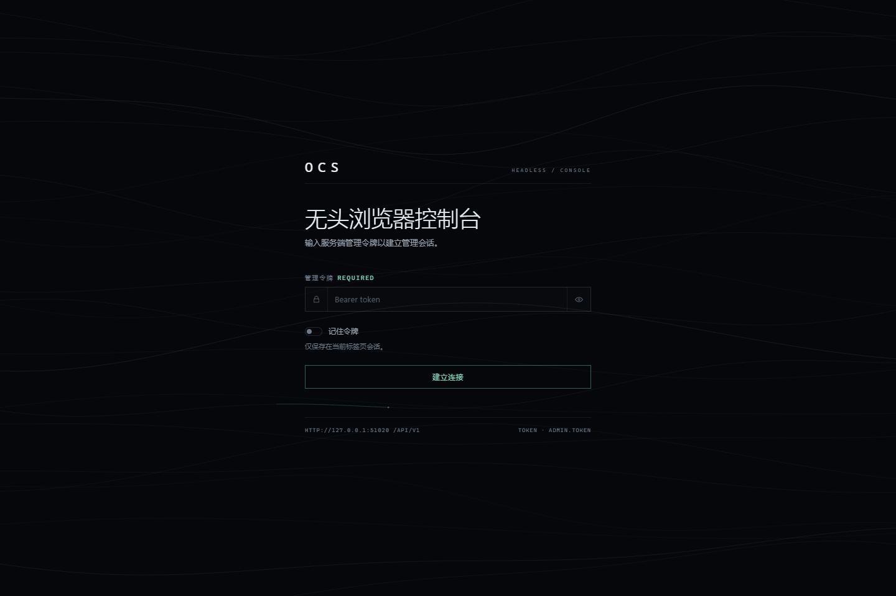
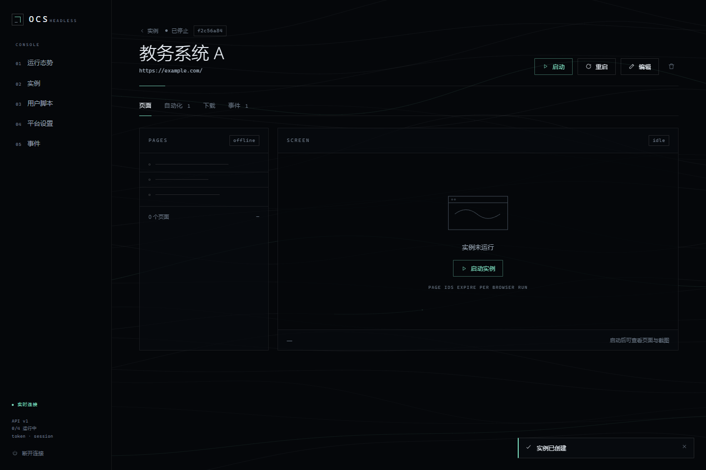
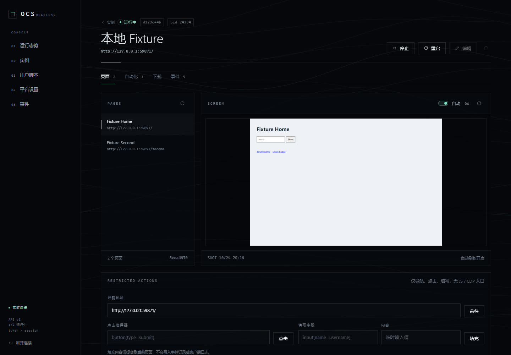
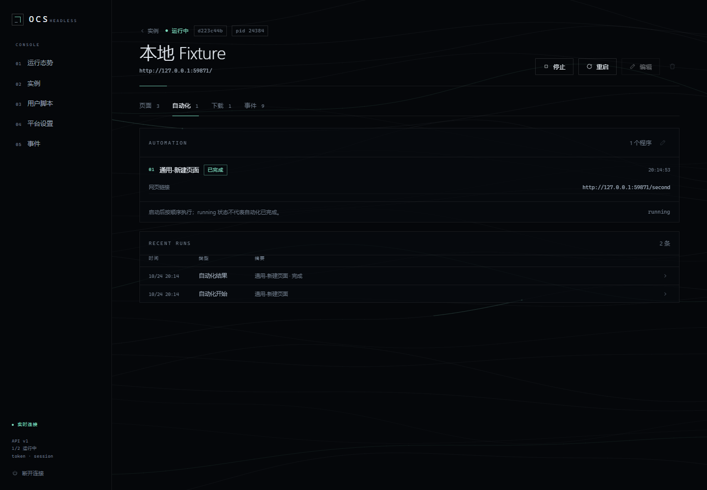
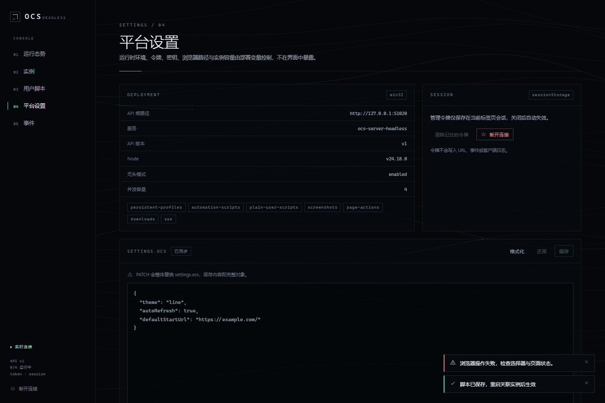

# Web 控制台

`packages/web-ui` 是连接 `/api/v1` 的浏览器管理界面。技术栈为 Vue 3 + Vite + TypeScript，不使用 UI 组件库、外部字体或图标依赖。构建产物默认写入 `packages/server/web`，由服务端同源托管。



## 设计语言

- 深色近黑底、1px 发丝线、细线图标；单一薄荷绿强调色，状态色只用于运行、警告与错误。
- 全站不使用渐变、发光、投影或玻璃拟态。背景是 24 条低透明度流线与 2 段游走亮线组成的 Canvas；`prefers-reduced-motion` 下静态绘制，标签页隐藏时停止绘制。
- 动效只用于状态变化、线条绘制与页面切换：状态过渡约 120–300ms，线条绘制不超过 800ms；持续流动的 Canvas 与状态脉冲只作低强度反馈。
- 文本克制：只保留不可省略的约束，例如密码 `***`、不支持 `GM_*`、`settings.ocs` 整体替换、来源被拒绝、填充内容不回显；其余信息用数字、状态点、标签与结构表达。
- 响应式：`<=900px` 侧栏折叠为双行顶部导航，表格移除次要列；`<=560px` 标题与操作改为纵向。






## 目录与职责

```text
src/api/client.ts       fetch 封装、Bearer、错误分类、Blob 与下载进度
src/api/stream.ts       带 Bearer 的 fetch SSE、心跳看门狗、退避重连
src/api/endpoints.ts    按资源分组的接口调用
src/stores/session.ts   令牌存储、启动校验、401 失效处理
src/stores/service.ts   系统/实例/脚本/设置数据与实例操作
src/stores/events.ts    事件缓存、SSE 生命周期、事件到状态的归并
src/components/         线框基础组件、实例表单、页面/下载/自动化面板、FlowField 背景
src/views/              连接、概览、实例、详情、脚本、设置、事件
src/styles/             设计令牌、基础布局、组件样式
tests/console.e2e.cjs   真实浏览器端到端检查
```

## 接口类型与共享契约

`src/api/types.ts` 镜像 `packages/server/src/types.ts` 与 `/automation-scripts` 的配置定义，`src/lib/config.ts` 镜像 common 的配置校验。控制台不直接依赖 `@ocs-server/common` 的 CommonJS 产物，避免浏览器构建引入 Playwright / Node 代码；契约变更时需同时更新镜像类型，并由 `pnpm test:web` 覆盖主流程。自动化配置和详情根据 `needOCR` 提示验证码识别限制，运行日志展示 `automation-warning`；该提示不阻止无验证码的登录。

## 认证与凭据

- 默认写入 `sessionStorage`，关闭标签页后失效。勾选“记住令牌”后写入 `localStorage`，设置页提供清除入口。
- 令牌只通过 `Authorization: Bearer` 发送；不进入 URL、查询参数、事件、Toast 或客户端日志。事件流使用 `fetch` 读取，原生 `EventSource` 无法附加该请求头。
- 401 清理会话并回到连接页；403 显示 `OCS_ALLOWED_ORIGINS` 配置提示。连接页不会回显令牌内容。

## 数据流

- 认证成功后并行读取 `/system`、`/automation-scripts`、`/browsers`、`/user-scripts` 与 `/settings`。
- SSE 重连携带 `Last-Event-ID`；45 秒无数据视为断线。退避从 700ms 指数增长，上限 15 秒。重连后重新同步实例、脚本与近期日志。本地最多保留 400 条，按时间与事件 ID 去重。
- 截图与下载使用带 Bearer 的 `fetch` 转 Blob。截图轮询只在实例运行、页面可见且用户未暂停时执行；切换页面、实例或离开视图会取消请求并释放 Object URL。
- 自动化表单由 `/automation-scripts` 的配置定义生成，支持 `visibleWhen`、必填、长度/范围、选项与开关。密码读取为 `***`，未点击“修改”时按原值提交。
- 设置页按整体替换语义提交 `settings.ocs`，提交前校验 JSON 对象。

## 开发

```bash
pnpm install

# 终端 1：后端
OCS_DATA_DIR=/tmp/ocs-dev OCS_ALLOWED_ORIGINS=http://localhost:3000 pnpm dev

# 终端 2：前端
pnpm dev:web
```

- Vite 默认使用 `http://localhost:3000`，将 `/api` 与 `/healthz` 代理到 `http://127.0.0.1:15319`；设置 `OCS_DEV_BACKEND` 可指向其他后端。
- 代理默认保留 Host 与 Origin，后端按同源处理。如果改成 `changeOrigin`、改用其他域名访问，或把控制台与 API 分离，需要把对应来源加入 `OCS_ALLOWED_ORIGINS`；否则连接页会显示 403 提示。
- 也可以构建后由后端同源提供：`pnpm build:web && pnpm start`。

### 可选构建变量

- `VITE_API_BASE`：构建时指定 API 源，例如 `https://ocs.example.com`；默认同源。设置后需要把控制台来源加入 `OCS_ALLOWED_ORIGINS`。
- `OCS_DEV_BACKEND`：仅开发代理使用，不进入构建产物。

## 构建、托管与部署

- `pnpm build:web`：类型检查并输出到 `packages/server/web`，其中 `assets/` 文件名带内容哈希。
- 后端启动时若 `OCS_WEB_DIR`（默认 `packages/server/web`）存在 `index.html`，在 `/` 提供控制台；不存在时保持纯 API 行为。`pnpm build` 不构建前端。
- 使用 hash 路由，不需要 SPA 重写；未知路径仍是 JSON 404。
- 服务端为 HTML 设置专用 CSP：`default-src 'self'`、`img-src 'self' blob: data:`、`style-src 'self' 'unsafe-inline'`、`script-src 'self'`。`index.html` 不缓存，哈希资源长期缓存。
- 推荐同源反向代理：页面与 `/api` 使用同一域名。为 `/api/v1/events` 关闭代理缓冲并保持长连接；后端已返回 `X-Accel-Buffering: no`。
- 服务端 CSP 的 `connect-src` 为 `'self'`，因此由本服务托管的控制台只应使用同源 API。如果控制台与 API 分离部署，需要由控制台托管方设置允许 API 源的 CSP，精确配置 `OCS_ALLOWED_ORIGINS`，并通过 `VITE_API_BASE` 构建。不要把令牌放进 URL。

## 测试

```bash
pnpm build
pnpm build:web
pnpm test:web
```

`tests/console.e2e.cjs` 启动临时后端与本地页面 fixture，用真实浏览器覆盖：无效令牌、会话 / 记住令牌存储、SSE 中断重连、用户脚本创建、条件字段、实例创建、启动/重启/停止、截图、填写/点击、导航、下载、自动化结果、事件展开、`settings.ocs` 整体替换、退出登录与来源 403。

默认使用 Playwright 安装的 Chromium。本机没有下载浏览器时可指定已安装的浏览器：

```bash
OCS_E2E_BROWSER=/绝对路径/chrome pnpm test:web
```

该变量同时传给后端 worker，保证实例使用同一浏览器。测试不访问外部网站。设置 `OCS_E2E_SHOTS=目录` 可在关键步骤保存截图，便于排查布局问题。

## 边界

- 单管理员令牌，没有角色或租户隔离。
- 不提供任意 JS、CDP、文件系统或 Node 执行入口；页面操作只有导航、点击、填写与截图。
- 不实现 `GM_*`、脚本管理器安装器、扩展商店或 OCR。
- 事件缓存不是任务数据库；服务重启后序号重新开始，以重新同步结果为准。
